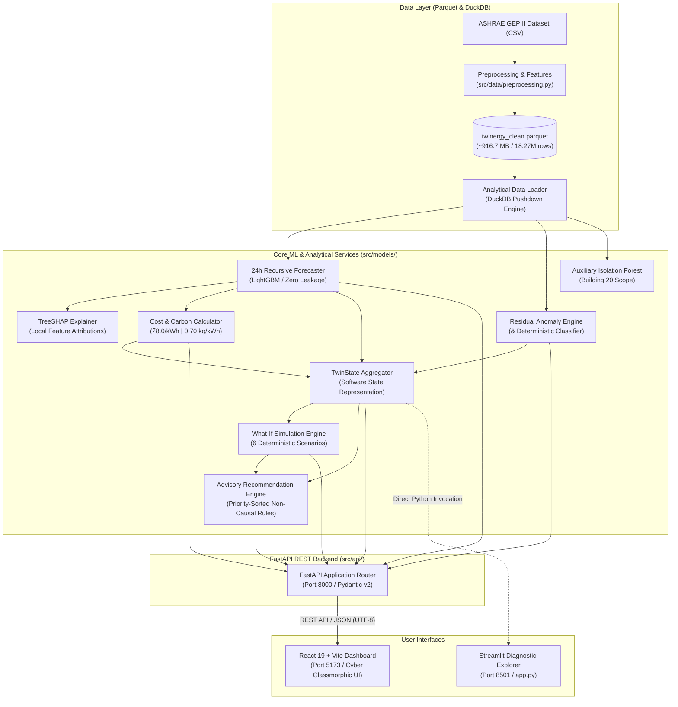

# 🏢 Twinergy
### AI-Driven Digital Twin for Building Energy Forecasting, Anomaly Diagnosis & Simulation

> **Twinergy** is a software digital twin framework for commercial and institutional building energy management. Built upon the ASHRAE Great Energy Predictor III benchmark dataset, it models multi-meter energy profiles, delivers recursive multi-step energy demand forecasting, diagnoses anomalies through contextual residual analysis, computes local TreeSHAP feature attributions, tracks financial and environmental impacts, and provides simulation-backed energy conservation recommendations through a modern React web application backed by a FastAPI REST API.

---

## 1. Project Overview

### Problem Statement
Commercial and institutional facilities account for a substantial fraction of global electrical energy consumption and greenhouse gas emissions. Facility managers and operations engineers often lack unified tools that combine forward-looking predictive demand trajectories, explainable anomaly detection, tariff-aware financial analytics, and interactive simulation sandbox environments. Existing building management systems (BMS) are typically siloed, reactive, and lack predictive intelligence without target data leakage.

### Purpose
Twinergy provides a modular, decoupled, and verifiable software digital twin architecture that:
1. **Aggregates historical multi-meter energy observations** across electricity, chilled water, steam, and hot water.
2. **Forecasts 24-hour forward energy trajectories** using an autoregressive LightGBM pipeline with zero future target leakage.
3. **Detects and classifies consumption anomalies** using contextual residual thresholds and rule-based diagnostic categories.
4. **Quantifies financial cost and carbon emissions** under standardized, configurable tariff and emission intensity baselines.
5. **Enables interactive what-if demand simulation** without mutating baseline historical records or active model states.
6. **Delivers priority-ordered, non-causal efficiency recommendations** directly to building operators via a cyber-industrial glassmorphism web dashboard.

### Intended Users
- **Building Energy Managers & Facility Engineers:** Monitoring real-time telemetry representations and responding to contextual anomaly alerts.
- **Sustainability & ESG Officers:** Tracking carbon abatement potentials, evaluating efficiency retrofit scenarios, and verifying emissions profiles.
- **Academic Researchers & Data Scientists:** Validating multi-step time-series forecasting, leakage-free autoregression, and model explainability on benchmark datasets.

---

## 2. Current Implementation Status

| Component / Layer | Module / Path | Status | Verification & Evidence |
|---|---|---|---|
| **Columnar Data Storage** | `twinergy_clean.parquet` (916.7 MB) | **Operational** | ZSTD-compressed Parquet generated from 6.34 GB CSV (6.6x compression). |
| **Analytical Data Loader** | `src/data/loader.py` (`DataLoader`) | **Operational** | Pushdown SQL queries via DuckDB with automatic PyArrow/pandas fallback. |
| **Data Contract Suite** | `src/data/validation.py` | **Operational** | 9 automated schema, nullity, and monotonicity assertions passing (9/9). |
| **Core LightGBM Forecaster** | `src/models/forecasting.py` | **Operational** | 22-feature booster (`twinergy_lgbm.pkl`) predicting log1p and inverted kWh. |
| **Recursive 24h Forecaster** | `src/models/forecasting.py` (`forecast_24h`) | **Operational** | Dynamic rolling lag buffer; zero future target leakage verified by unit tests. |
| **Contextual Residual Anomaly Detector** | `src/models/anomaly.py` (`EnergyAnomalyAnalyzer`) | **Operational** | Relative deviation thresholds (Warning > 25%, Critical > 50%) and 5 category types. |
| **Auxiliary Isolation Forest** | `src/models/anomaly.py` (`AnomalyDetector`) | **Operational** | 8-feature unsupervised model (`twinergy_isoforest.pkl`); Building 20 scope flagged. |
| **Explainability Service** | `src/models/explainability.py` (`ModelExplainer`) | **Operational** | TreeSHAP additive decomposition (`ŷ = E[ŷ] + Σ φ_i`) and global tree gain. |
| **Cost & Carbon Calculator** | `src/models/impact.py` (`EnergyImpactCalculator`) | **Operational** | Standardized ₹8.00/kWh tariff and 0.70 kg CO₂e/kWh grid carbon factor. |
| **Digital Twin State Aggregator** | `src/models/twin_state.py` (`TwinState`) | **Operational** | Aggregated telemetry, forecast, impact, and status (`NORMAL`, `WARNING`, etc.). |
| **What-If Simulation Engine** | `src/models/simulation.py` (`EnergySimulationEngine`) | **Operational** | 6 deterministic scenario types; strictly preserves baseline immutability. |
| **Advisory Recommendation Engine** | `src/models/recommendations.py` (`RecommendationEngine`) | **Operational** | Priority-ordered advisory rules (`CRITICAL` → `INFO`) with data-backed evidence. |
| **FastAPI REST API** | `src/api/` (`main.py`, `routes/`, `schemas.py`) | **Operational** | 8 production endpoints, Pydantic v2 validation, explicit UTF-8 response headers. |
| **React Web Frontend** | `frontend/` (React 19 + Vite) | **Operational** | 8 modular panels, custom responsive SVG charts, AbortController request cancellation. |
| **Legacy Streamlit Dashboard** | `app.py` | **Operational** | 10-panel vertical diagnostic explorer for local offline inspection. |

---

## 3. End-to-End System Architecture

The architecture is organized into decoupled layers: the analytical data foundation, domain and machine learning services, the REST API boundary, and the presentation interfaces.



---

## 4. Implemented Feature Details

### 4.1 Recursive 24-Hour Forward Forecasting
- **Underlying Booster:** LightGBM Regressor (`twinergy_lgbm.pkl`) trained on log-transformed energy target `meter_reading_log = ln(1 + meter_reading)`.
- **Zero Target Leakage Multi-Step Recursion:** The forecaster dynamically updates an autoregressive rolling buffer across horizons `t+1` to `t+24`. As predictions are made on the log scale, they are appended to the lag buffer to compute subsequent autoregressive lags (`lag_1hr`, `lag_24hr`, `lag_168hr`) and rolling statistics (`rolling_mean_6hr`, `rolling_mean_24hr`, `rolling_std_24hr`, `rolling_mean_168hr`). Future actual energy readings are strictly excluded.
- **Physical Inversion:** Predictions are inverted back to physical engineering units (kWh) via `expm1` and lower-bounded at `0.0`.

### 4.2 Contextual Residual Anomaly Detection & Classification
- **Primary Residual Engine:** Evaluates observed consumption (`y_t`) against expected model baseline (`ŷ_t`):
  - Residual formula: `e_t = y_t - ŷ_t`
  - Deviation ratio: `δ_t = e_t / max(ŷ_t, ε)`
  - Classification thresholds:
    - `NORMAL`: `|δ_t| ≤ 25%`
    - `WARNING`: `25% < |δ_t| ≤ 50%`
    - `CRITICAL`: `|δ_t| > 50%`
- **Deterministic 5-Tier Category Classifier:** Classifies anomalies into `NORMAL`, `LOW_DEMAND`, `RAPID_SPIKE`, `PERSISTENT_HIGH`, or `HIGH_DEMAND` with human-readable diagnostic reasons.
- **Auxiliary Isolation Forest Signal:** Evaluates multidimensional density over 8 features (`twinergy_isoforest.pkl`). **Scope Disclosure:** Trained strictly on Building 20; cross-building flags are uncalibrated and flagged as auxiliary evidence.

### 4.3 TreeSHAP Explainability vs. Tree Split Gain
- **Local Additive TreeSHAP:** Decomposes individual predictions into additive feature attributions:
  - Additive attribution: `ŷ = E[ŷ] + Σ φ_i`
- **Safety Bounding:** Capped at a maximum sample size (default 100 rows) to prevent CPU/memory exhaustion.
- **Methodological Distinction:** Tree split gain (total loss reduction across splits) is explicitly decoupled from local SHAP attribution. Explanations reflect mathematical model feature weighting, not physical real-world causality.

### 4.4 Cost & Carbon Impact Modeling
- **Standardized Assumptions:** Standard baseline electricity tariff of **₹8.00/kWh** and grid carbon intensity of **0.70 kg CO₂e/kWh**.
- **Calculations:** Computes hourly cost trajectories and cumulative 24-hour financial and emissions totals with non-negative, finite boundary assertions.

### 4.5 Digital Twin Software State (`TwinState`)
- Centralized software state object encapsulating:
  - Building identity (`building_id`, `meter`, `timestamp`).
  - Observed and expected consumption metrics (`actual_kwh`, `expected_kwh`, `residual_kwh`, `deviation_ratio`).
  - Anomaly status (`severity`, `anomaly_type`, `classification_reason`).
  - 24-hour forecast summary (`forecast_total_kwh`, `forecast_peak_kwh`, `forecast_peak_hour`).
  - Financial/carbon footprint (`forecast_total_cost`, `forecast_total_carbon_kg`).
  - Aggregated system health (`NORMAL`, `WARNING`, `CRITICAL`, `UNAVAILABLE`).
- Serializes to ISO-8601 UTC native dictionaries via `.to_dict()`.

### 4.6 What-If Demand Scenario Simulation
- Simulates 6 deterministic operational adjustments on the 24-hour baseline forecast:
  1. `ENERGY_MULTIPLIER`: Uniform proportional scaling (e.g., `1.15` for +15% surge).
  2. `ENERGY_REDUCTION`: Fractional load curtailment (e.g., `0.10` for 10% load shed).
  3. `FIXED_KWH_ADDITION`: Constant baseline shift (e.g., `+20.0 kWh` for baseload/EV charging).
  4. `OCCUPANCY_CHANGE`: Business-hours demand modulation using occupancy proxy heuristics.
  5. `TEMPERATURE_CHANGE`: Weather sensitivity adjustment (~2.5% demand shift per +1°C).
  6. `EFFICIENCY_MULTIPLIER`: Equipment retrofit efficiency gain (e.g., `0.85` for 15% efficiency gain).
- **Baseline Immutability:** All simulations operate strictly on copies of forecast data in memory, ensuring zero mutation of baseline forecasts or trained models.

### 4.7 Advisory Recommendation Engine
- Generates priority-ordered advisory efficiency guidelines (`CRITICAL` → `HIGH` → `MEDIUM` → `LOW` → `INFO`).
- Categories: `ENERGY`, `ANOMALY`, `COST`, `CARBON`, `OPERATIONS`.
- Non-causal phrasing: Recommendations use advisory verbs ("Review", "Investigate", "Consider") and cite specific numerical evidence from active TwinState and simulation results.

---

## 5. Dataset Specifications & Limitations

- **Source Dataset:** ASHRAE Great Energy Predictor III (GEPIII) Kaggle benchmark merged with building metadata and site weather observations.
- **Temporal Coverage:** Hourly records spanning calendar year 2016 (`2016-01-02 00:00:00` to `2016-12-31 23:00:00`).
- **Scale:** `18,266,719` total rows, `37` canonical columns, `1,449` unique buildings across `16` geographic sites.
- **Meter Types:**
  - `0`: Electricity (Primary modeled meter)
  - `1`: Chilled Water
  - `2`: Steam
  - `3`: Hot Water
- **Storage Artifacts:**
  - Raw cleaned CSV: `twinergy_clean.csv` (6.34 GB)
  - Columnar Parquet: `twinergy_clean.parquet` (961.2 MB / 916.7 MiB, ZSTD compressed)
- **Data Limitations & Disclosures:**
  1. *Historical Benchmark:* All observations reflect historical 2016 conditions. They do not represent live IoT sensor feeds.
  2. *Sparse Metadata:* Year built (60.2% null) and floor count (82.3% null) are sparse in source data; median imputation is used where applicable.
  3. *Engineered Occupancy Proxy:* The feature `occupancy_proxy` is an engineered mathematical heuristic (`is_business_hours × rolling_mean_6hr`), not an IoT-measured headcount.

---

## 6. Machine Learning Model Methodology

### LightGBM Energy Forecaster (`twinergy_lgbm.pkl`)
- **Objective:** Regression (`root_mean_squared_error`) on target `meter_reading_log = ln(1 + meter_reading)`.
- **Feature Contract (22 Features):**
  1. `hour`, `dayofweek`, `month`, `dayofyear`, `is_weekend`, `is_business_hours`
  2. `hour_sin`, `hour_cos`, `month_sin`, `month_cos` (Cyclic trigonometric encodings)
  3. `lag_1hr`, `lag_24hr`, `lag_168hr` (Autoregressive lags)
  4. `rolling_mean_6hr`, `rolling_mean_24hr`, `rolling_std_24hr`, `rolling_mean_168hr` (Rolling statistics)
  5. `temp_x_hour`, `temp_x_weekend` (Weather-temporal interactions)
  6. `occupancy_proxy` (Engineered schedule proxy)
  7. `air_temperature`, `square_feet` (Ambient weather and building scale)

### Isolation Forest Anomaly Detector (`twinergy_isoforest.pkl`)
- **Objective:** Unsupervised out-of-distribution anomaly scoring over 8 features.
- **Critical Limitation:** Trained exclusively on **Building 20**. Its inferences on other buildings serve strictly as uncalibrated auxiliary signals and are explicitly documented as such.

---

## 7. Project Directory Structure

```
twinenergy/
├── .gitignore                           # Git ignore rules (node_modules, dist, cache, data)
├── app.py                              # Legacy Streamlit diagnostic dashboard (1,253 lines)
├── DATA_CONTRACT.md                    # Canonical 37-column schema & feature dictionary
├── README.md                           # Comprehensive project reference documentation
├── requirements.txt                    # Python environment dependencies
├── twinergy_clean.parquet              # Columnar compressed dataset (~916.7 MB)
├── twinergy_isoforest.pkl              # Auxiliary Isolation Forest model artifact (Building 20)
├── twinergy_lgbm.pkl                   # Primary LightGBM forecaster model artifact
│
├── frontend/                           # React 19 + Vite Web Application
│   ├── .env.example                    # Frontend environment template (VITE_API_BASE_URL)
│   ├── index.html                      # HTML5 entry with Inter font & dark canvas
│   ├── package.json                    # Dependencies (React 19, Lucide, Vitest, Vite)
│   ├── vite.config.js                  # Vite development server & test configuration
│   └── src/
│       ├── App.jsx                     # Top-level container with request cancellation
│       ├── index.css                   # Cyber-industrial glassmorphism design tokens
│       ├── components/
│       │   ├── Header.jsx              # Navigation, building/meter selectors, health status
│       │   ├── EnergyOverview.jsx      # High-level summary KPI cards
│       │   ├── ForecastPanel.jsx       # 24h hourly forecast with interactive SVG line chart
│       │   ├── AnomalyPanel.jsx        # Residual anomaly log + Isolation Forest signal
│       │   ├── ImpactPanel.jsx         # 24h cost (₹) and carbon (kg CO2e) breakdown
│       │   ├── TwinStatePanel.jsx      # Structured digital twin telemetry viewer
│       │   ├── RecommendationsPanel.jsx# Advisory energy conservation recommendations
│       │   ├── SimulationPanel.jsx     # Interactive what-if scenario simulator
│       │   ├── charts/LineChart.jsx    # Pure SVG dual-series responsive chart
│       │   └── common/                 # LoadingSpinner, ErrorMessage, EmptyState
│       ├── services/api.js             # Centralized API client with AbortController
│       └── tests/                      # 7 Vitest test suites (25 tests passing)
│
├── src/
│   ├── api/                            # FastAPI REST API Layer
│   │   ├── main.py                     # Application factory, CORS, UTF8JSONResponse, exceptions
│   │   ├── schemas.py                  # Pydantic v2 request/response schemas
│   │   ├── services.py                 # Backend singleton loaders & cache managers
│   │   └── routes/
│   │       ├── health.py               # Health check endpoint (/health)
│   │       └── buildings.py            # Building state, forecast, anomalies, impact, sim routes
│   │
│   ├── data/                           # Data Pipeline & Analytics Layer
│   │   ├── feature_engineering.py      # Autoregressive lags, rollings, calendar, occupancy proxy
│   │   ├── loader.py                   # High-performance DuckDB / PyArrow data loader
│   │   ├── preprocessing.py            # Weather cleaning, outlier clipping, dataset alignment
│   │   ├── schema.py                   # Canonical 37-column schema & 22-feature contracts
│   │   └── validation.py               # 9 automated data contract validation checks
│   │
│   └── models/                         # Domain Models & Machine Learning Core
│       ├── anomaly.py                  # Residual anomaly detector & 5-tier rule classifier
│       ├── explainability.py           # Local TreeSHAP additive explainer & global feature gain
│       ├── forecasting.py              # Recursive 24-step forecaster (zero target leakage)
│       ├── impact.py                   # Financial cost (₹) & carbon emissions (kg CO2e) engine
│       ├── recommendations.py          # Priority-ordered advisory efficiency recommendation engine
│       ├── simulation.py               # Deterministic what-if scenario simulation engine
│       └── twin_state.py               # TwinState data class, transition rules, and builder
│
├── tests/                              # Comprehensive Python Pytest Suite (107 tests)
│   ├── test_anomaly.py                 # Residual calculations, relative deviation, severity tests
│   ├── test_anomaly_classification.py  # Anomaly category heuristic priority tests
│   ├── test_api.py                     # 26 FastAPI endpoint integration tests
│   ├── test_building_month_display.py  # Data availability and KPI regression tests
│   ├── test_data_foundation.py         # Loader, schema, and model contract tests
│   ├── test_explainability.py          # TreeSHAP structure and additive property tests
│   ├── test_forecast_24h.py            # 24h recursive forecasting & zero target leakage tests
│   ├── test_impact.py                  # Cost & carbon calculation and boundary tests
│   ├── test_models.py                  # Model loading and regression consistency tests
│   ├── test_recommendations.py         # Recommendation generation, sorting, and format tests
│   ├── test_simulation.py              # Scenario engines and non-mutation assertions
│   └── test_twin_state.py              # TwinState creation, status transitions, and serialization
│
└── scripts/
    └── prepare_data.py                 # Automated CSV to Parquet conversion script
```

---

## 8. Prerequisites & Environment Setup

### Prerequisites
- **Python:** 3.10 to 3.13
- **Node.js:** 18+ and `npm`
- **Git**

### Installation

#### Windows PowerShell
```powershell
# 1. Clone repository
git clone https://github.com/BharathKumarBD/Major_Project_2026.git
cd Major_Project_2026

# 2. Set up Python virtual environment (optional but recommended)
python -m venv venv
.\venv\Scripts\Activate.ps1

# 3. Install Python backend dependencies
python -m pip install --upgrade pip
pip install -r requirements.txt

# 4. Install React frontend dependencies
cd frontend
npm install
cd ..
```

#### macOS / Linux
```bash
# 1. Clone repository
git clone https://github.com/BharathKumarBD/Major_Project_2026.git
cd Major_Project_2026

# 2. Set up Python virtual environment
python3 -m venv venv
source venv/bin/activate

# 3. Install Python backend dependencies
pip install --upgrade pip
pip install -r requirements.txt

# 4. Install React frontend dependencies
cd frontend
npm install
cd ..
```

---

## 9. Environment Configuration

Twinergy works out-of-the-box using project root defaults, but supports explicit environment configuration:

| Variable | Default Value | Description |
|---|---|---|
| `TWINERGY_DATA_PATH` | `<root>/twinergy_clean.parquet` | Custom path to the Parquet or CSV dataset file. |
| `TWINERGY_LGBM_PATH` | `<root>/twinergy_lgbm.pkl` | Custom path to the LightGBM forecaster artifact. |
| `TWINERGY_ISOFOREST_PATH` | `<root>/twinergy_isoforest.pkl` | Custom path to the Isolation Forest model artifact. |
| `VITE_API_BASE_URL` | `http://127.0.0.1:8000` | Base URL used by the React frontend to reach FastAPI. |

For frontend configuration, copy `frontend/.env.example` to `frontend/.env`:
```bash
cd frontend
cp .env.example .env
```

---

## 10. Execution Instructions

### Terminal 1: Run the FastAPI Backend Server
From the project root directory:

**Windows PowerShell:**
```powershell
python -m uvicorn src.api.main:app --reload --host 127.0.0.1 --port 8000
```

**macOS / Linux:**
```bash
python3 -m uvicorn src.api.main:app --reload --host 127.0.0.1 --port 8000
```

- **Health Check:** [http://127.0.0.1:8000/health](http://127.0.0.1:8000/health)
- **Interactive Swagger Documentation:** [http://127.0.0.1:8000/docs](http://127.0.0.1:8000/docs)
- **OpenAPI Schema Contract:** [http://127.0.0.1:8000/openapi.json](http://127.0.0.1:8000/openapi.json)

---

### Terminal 2: Run the React Web Application
In a separate terminal window:

```bash
cd frontend
npm run dev
```

- **Dashboard UI:** Open [http://localhost:5173](http://localhost:5173) in your browser.

---

### Terminal 3 (Optional): Run the Legacy Streamlit Explorer
In a separate terminal window:

**Windows PowerShell:**
```powershell
python -m streamlit run app.py
```

**macOS / Linux:**
```bash
streamlit run app.py
```

- **Streamlit Interface:** Open [http://localhost:8501](http://localhost:8501) in your browser.

---

## 11. REST API Reference

The FastAPI backend exposes 8 REST endpoints adhering to strict Pydantic v2 schemas and explicit UTF-8 response encoding (`Content-Type: application/json; charset=utf-8`):

| HTTP Method | Route | Description | Query / Body Parameters |
|---|---|---|---|
| `GET` | `/health` | Service health, version, and status check. | None |
| `GET` | `/buildings` | List of available building IDs (1,449) and supported meters. | `meter` (optional int) |
| `GET` | `/buildings/{id}/state` | Aggregated Building Twin State (telemetry, forecast, impacts). | `meter` (int), `cutoff_time` (string) |
| `GET` | `/buildings/{id}/forecast` | 24-hour multi-step recursive hourly energy predictions. | `meter` (int), `cutoff_time` (string) |
| `GET` | `/buildings/{id}/anomalies` | Contextual residual anomaly detections & Isolation Forest signals. | `meter` (int), `cutoff_time` (string), `anomalies_only` (bool) |
| `GET` | `/buildings/{id}/impact` | 24-hour cost (₹) and carbon (kg CO₂e) footprint trajectory. | `meter`, `tariff_per_kwh`, `carbon_intensity_kg_per_kwh` |
| `GET` | `/buildings/{id}/recommendations` | Priority-ordered advisory energy conservation measures. | `meter`, `cost_threshold`, `carbon_threshold` |
| `POST` | `/buildings/{id}/simulate` | Evaluates what-if scenario impacts against baseline forecast. | Body: `{ scenario_type, value, meter?, tariff_per_kwh? }` |

---

## 12. Automated Testing & Verification Suite

All backend and frontend automated test suites pass without failure:

```powershell
# 1. Run Data Foundation Contract Validation (9 checks)
python src/data/validation.py
# Result: 9 passed, 0 failed (all checks passed)

# 2. Run Backend Python Pytest Suite (107 tests)
python -m pytest tests/ -v
# Result: 107 passed, 0 failed in ~30s (all 107 tests passed)

# 3. Run React Frontend Vitest Suite (25 tests across 7 test files)
cd frontend
npm test -- --run
# Result: 25 passed, 0 failed in ~4.4s (all 25 tests passed)

# 4. Compile Frontend Production Bundle
npm run build
# Result: Clean build (291 kB JS / 7.5 kB CSS, 0 errors)
```

---

## 13. Troubleshooting & Frequently Asked Questions

### 1. Corrupted Rupee Symbol (`â¹` / `₹`) in API Responses
- **Cause:** When HTTP responses omit explicit `charset=utf-8`, Windows terminals and legacy HTTP clients decode UTF-8 byte sequences (`\xe2\x82\xb9`) using Windows-1252 (ANSI), causing mojibake.
- **Resolution:** The FastAPI application enforces `UTF8JSONResponse` with `media_type = "application/json; charset=utf-8"` across all routes and error handlers. The React frontend also includes sanitization in `RecommendationsPanel.jsx` to ensure clean rendering.

### 2. Primary Residual Anomaly reports `NORMAL` while Isolation Forest flags `1`
- **Cause:** This is expected behavior. The primary residual engine measures 1D deviation from expected energy baseline. The auxiliary Isolation Forest is an unsupervised model trained strictly on Building 20 evaluating multi-feature space outliers.
- **Resolution:** The UI and API explicitly separate these two signals into primary and auxiliary cards with scope disclosures.

### 3. Missing Weather Observations for Certain Cutoff Times
- **Cause:** The dataset spans calendar year 2016. If a cutoff time is chosen near the end of the year without future weather data in the historical file, the forecaster raises a 400 error rather than fabricating synthetic future temperatures.
- **Resolution:** Provide future temperature arrays via the `future_weather` parameter or select a cutoff timestamp within the populated 2016 historical window.

### 4. CORS Issues During Frontend Development
- **Cause:** React running on `localhost:5173` connecting to backend on `127.0.0.1:8000`.
- **Resolution:** FastAPI `main.py` is pre-configured with `CORSMiddleware` supporting all local development origins.

---

## 14. Critical Domain Disclosures & Limitations

1. **Software Digital Twin vs. Physical Building Sensors:**
   TwinState is a software analytical construct derived from historical ASHRAE GEPIII time-series data. It is not connected to physical building automation actuators, live IoT gateways, or real-time BMS hardware.
2. **Occupancy Proxy (`occupancy_proxy`):**
   This feature is strictly an engineered mathematical heuristic (`is_business_hours × rolling_mean_6hr`), not an IoT-measured room headcount.
3. **Model Attribution vs. Physical Causality:**
   TreeSHAP explanations describe internal LightGBM decision tree feature attributions. They do not prove real-world physical causation.
4. **Tariff and Grid Carbon Assumptions:**
   Baseline financial tariffs (₹8.00/kWh) and grid carbon factors (0.70 kg CO₂e/kWh) are standardized demonstration parameters, not measured real-time utility billing or dynamic marginal grid emissions.
5. **Isolation Forest Model Scope:**
   `twinergy_isoforest.pkl` was trained exclusively on **Building 20**. It is preserved strictly as secondary auxiliary evidence.
6. **Non-Mutation of Historical Baselines:**
   What-if simulations evaluate hypothetical deviations in memory and strictly preserve baseline historical records and trained model weights.

---

## 15. Planned Future Scope

The following roadmap items represent genuinely unfinished future work:
- **Live Virtual BMS Gateway / Telemetry Replay Engine:** Sequential historical time-series replay emulating live MQTT/WebSocket BMS data streams.
- **Self-Adaptive Concept Drift Monitoring:** Population Stability Index (PSI) and Wasserstein Distance tracking to detect seasonal weather drift and schedule model recalibration.
- **Guarded Conversational Energy Assistant:** Domain-constrained, prompt-guarded natural language interface providing contextual explainability on building twin states.

---

*Twinergy Engineering Documentation — October 2026*
